## Hardware requirements

A minimum of 8 GB RAM and 20 GB free disk space is recommended for Podman Desktop,
and an up-to-date version of Windows 10 or 11, macOS 11+, or any RHEL-, Debian- or
Arch-based Linux distribution.

<!-- Min 6G Windows, 4 Mac, Linux? -->
Whilst Podman Desktop may run with less than 8 GB RAM, particularly on macOS
or Linux, at least 8 GB is recommended for good performance.

::: {.callout-note collapse=true}
## Podman 6 requirements

The latest major version of Podman, 6, dropped support for Windows 10 and
Intel-based Macs. If you are running on one of these devices, you will be limited to
features from Podman 5.x. This should have no implications for this course.
:::

Next, proceed to the instructions for your operating system:

* [Windows](#windows)
* [macOS](#macos)
* [Linux](#linux)

## Performing the installation

### Windows

#### Pre-installation: WSL 2

To use Podman you will need to activate the Windows Subsystem for Linux
(WSL). To do so, open a PowerShell terminal with **administrative privileges**
(right-click, then *Run as administrator*) and enter:

```powershell
wsl --install
```

You will then need to *restart* your computer to complete the installation. If
you don't have admin privileges on your device, ask an administrator for help.

#### Install Podman Desktop

Download the latest Windows installer for your processor (x64 or Arm64) from
[podman-desktop.io/downloads](https://podman-desktop.io/downloads).
Select *Only for me* and then *Install*. When complete, press *Finish*. You can
now start Podman Desktop using its desktop icon or by searching for 'Podman Desktop'
in the Start menu. If prompted, select *Allow* for public and private networks
and relaunch the application.

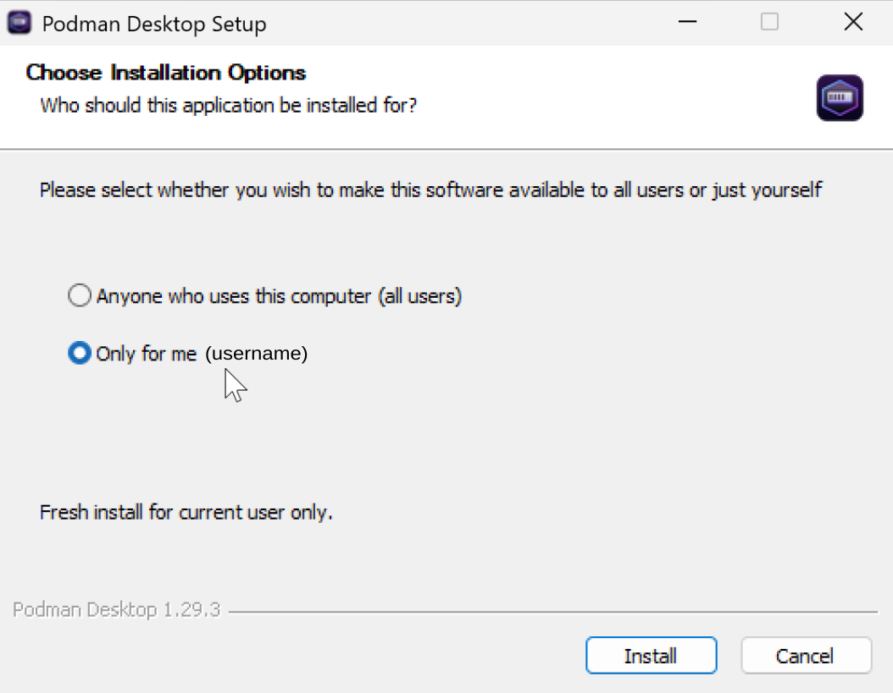

On first start, you will be greeted by the *Get Started with Podman
Desktop* screen. Assuming you have not installed the Podman CLI before, you *must* select
the Podman extension. You may optionally add the kubectl CLI and Compose
extensions, although we will not make use of either in this course.
You may also wish to untick Telemetry.

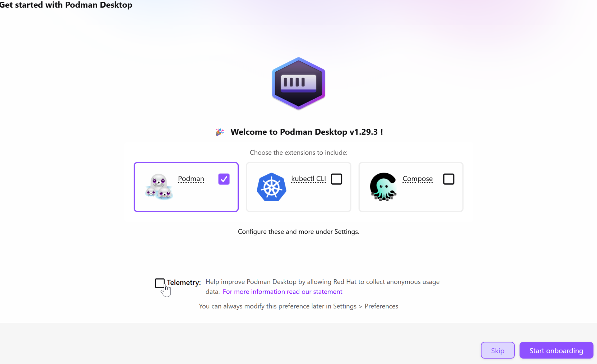

::: {.callout-tip collapse=true}
## Interrupted installation

If your installation is interrupted and you lose the *Get Started with Podman
Desktop* onboarding screen, you can install Podman at any time by starting
the desktop application and clicking *Set Up* in the Dashboard pane.
:::

Click *Start onboarding* to begin the setup of Podman and *Next* to initiate
installing Podman CLI. A pop-up, *Podman CLI Setup*, will appear. Select
*Windows Subsystem for Linux (WSL 2)* and *Next*.

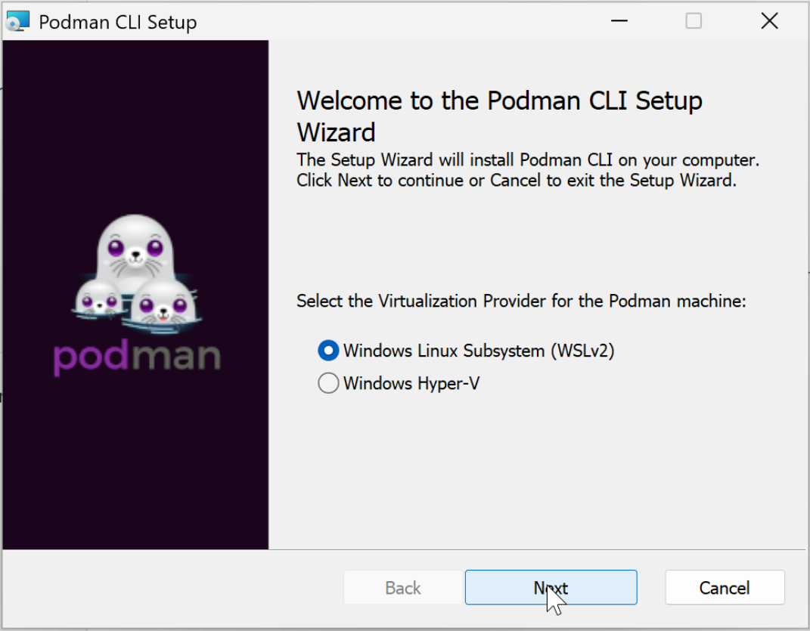


Once the Podman CLI install
has finished, you will be given the option to autostart the Podman engine when
launching Podman Desktop. We recommend leaving that enabled. Another screen will
then ask you to create a 'Podman machine'. Unless you have particular
requirements, leave the default settings and press *Create*. This may take
several minutes. When it completes, press *Next* to finish the installation and
open Podman Desktop.

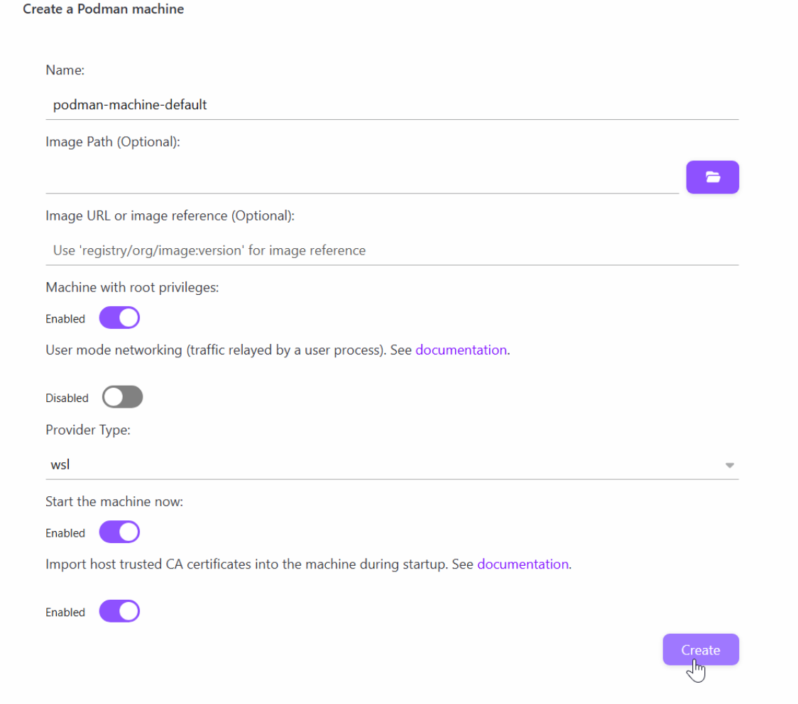

By default Podman Desktop is configured to autostart when you log in. If you do
not want this, it can be switched off from Settings (cog, bottom left corner) >
Preferences and then searching for 'Start on login'. Under *Preferences* you can
also configure Appearance settings such as theme (dark, light, high-contrast),
zoom level and font size. Under *Resources* you can check that your new Podman machine is
Running.

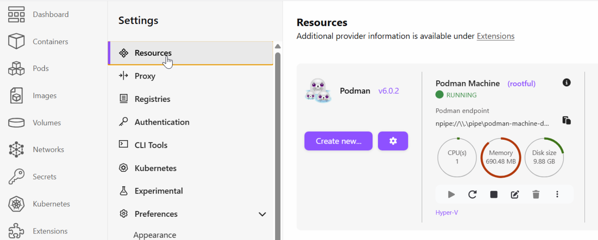

Proceed to [Verifying the installation](#verifying-the-installation).

### MacOS

#### Pre-installation: Rosetta 2
If you have a recent Mac with Apple Silicon (M1, M2, etc.) it is recommended to
install the Rosetta technology as this can significantly improve performance for
running containers built for Windows/Linux (x64-64) hardware. To install
Rosetta, or confirm it is already installed, open a Terminal application and
enter:
```
softwareupdate –install-rosetta
```

You may be required to authorise the installation with an administrators
password. No restart is required.


#### Install Podman Desktop
Download the Universal `*.dmg` from
[podman-desktop.io/downloads](https://podman-desktop.io/downloads).
Click on the `*.dmg` in Finder and in the window that appears,
drag the Podman Desktop icon to the Applications icon and release.
You will now be able to start Podman Desktop from the
Applications folder in Finder or by entering 'Podman' in
Spotlight Search (`Command (⌘) + Space`).

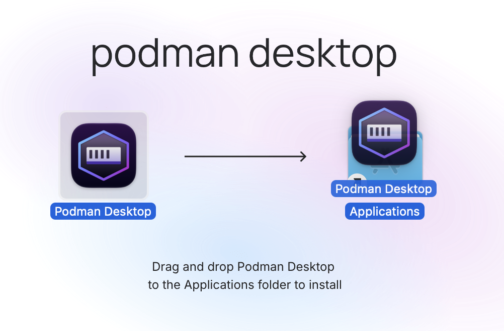

On first start, you will be greeted by a *Get Started with Podman Desktop*
screen. Assuming you have not installed the Podman CLI before, you *must* select
the Podman extension. You may optionally add the kubectl CLI and Compose
extensions, although we will not make use of either in this course.
You may also wish to untick Telemetry.

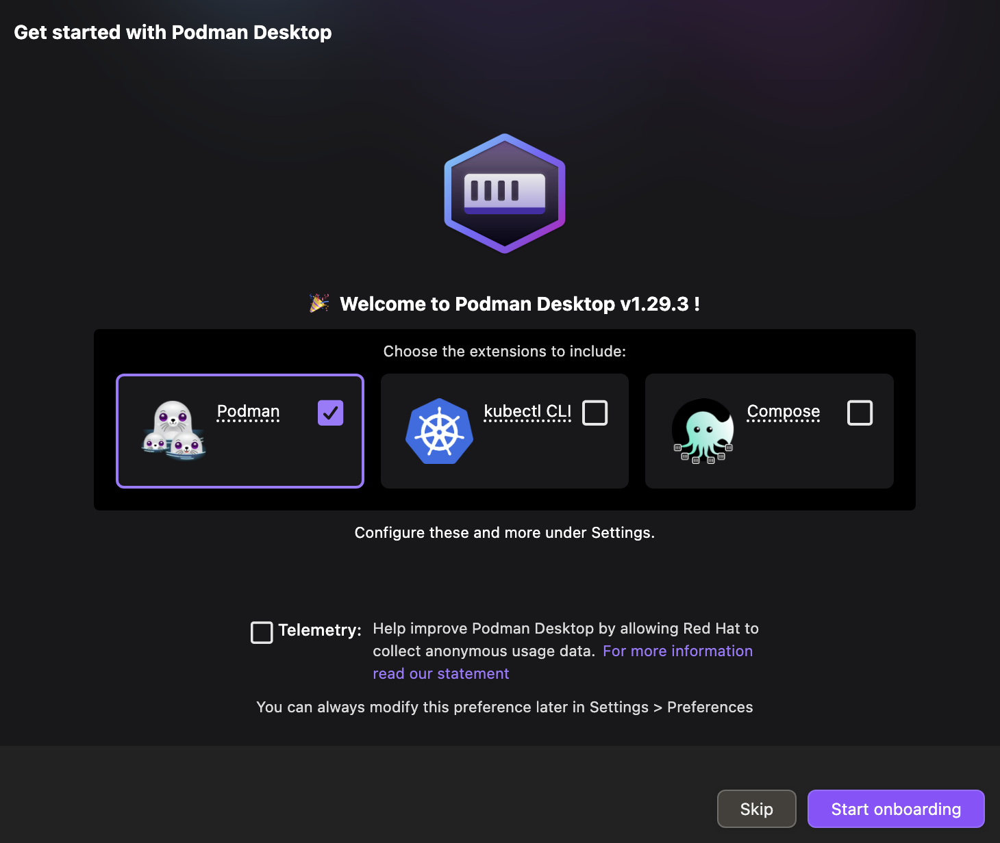

Click *Start onboarding* to begin the setup of Podman. A window to install
Podman CLI appears. Press *Continue* through the defaults and enter your
password to allow the installation if prompted. Once complete, click *Close* to
return to the onboarding screen which now indicates Podman has been setup
correctly. Leave the autostart option for Podman enabled and press *Next*.

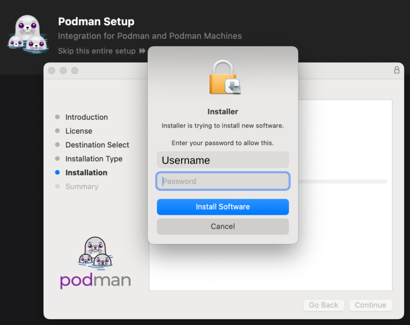

You will now be asked to create a 'Podman machine', which is a virtual portion of
your computer's resources that Podman will use to run containers. We recommend
leaving all the default settings, since they are calculated for your device, and
pressing *Create*. This may take a few minutes. When it completes, press *Next*
to finish the installation and open Podman Desktop.

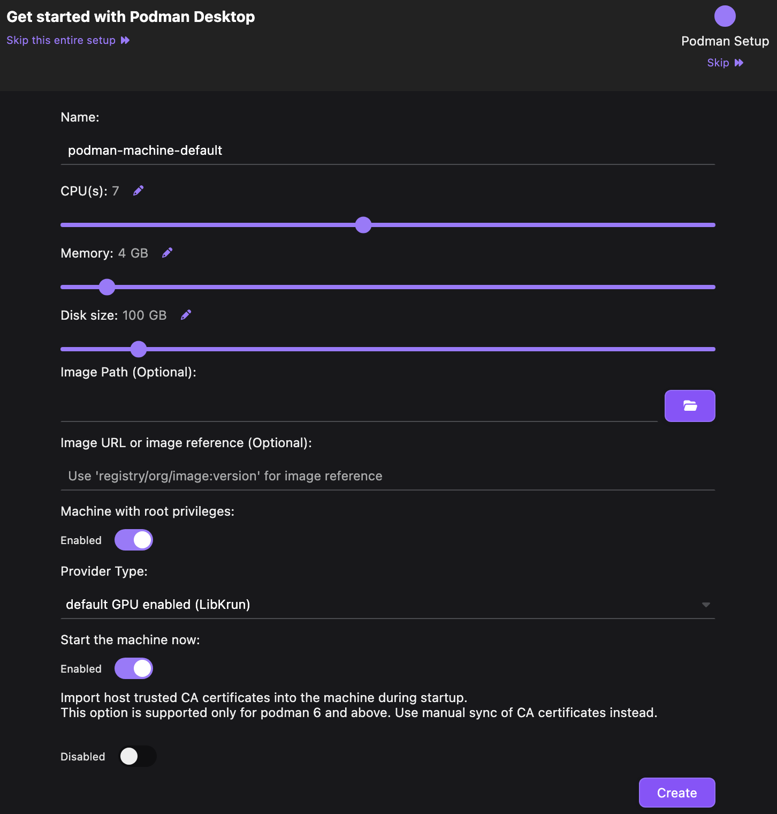

By default Podman Desktop is configured to autostart when you log in. If you do
not want this, it can be switched off from Settings (cog, bottom left corner) >
Preferences and then searching for 'Start on login'. Under *Preferences* you can
also configure Appearance settings such as theme (dark, light, high-contrast),
zoom level and font size. Under *Resources* you can check that your new Podman machine is
Running.

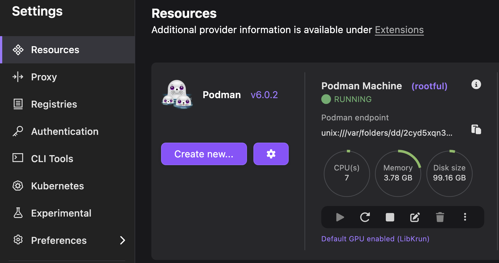

Proceed to [Verifying the installation](#verifying-the-installation).

### Linux

You will first need to install the `podman` command-line tool. For Debian-based
distributions (e.g. Ubuntu), run

```bash
sudo apt install podman
```

For other distributions, you will need to replace `apt install` with an
appropriate package manager install command.

The easiest way to install the desktop application is via Flatpak. First, make sure you have Flatpak
installed:

```bash
sudo apt update
sudo apt install flatpak
```

::: {.callout-tip collapse=true}
## Binary installation

It is also possible to install Podman Desktop by downloading the AMD64 binary
(tar.gz) directly from the Podman Desktop [Linux Downloads
page](https://podman-desktop.io/downloads/linux). This is useful for system-wide
installations in restricted environments, but the flatpak method is more
convenient for user installations and performing updates.
:::

Make sure the Flathub repository is enabled:

```bash
flatpak remote-add --if-not-exists --user flathub https://flathub.org/repo/flathub.flatpakrepo
```

Then install Podman Desktop:

```bash
flatpak install --user flathub io.podman_desktop.PodmanDesktop
```

Podman Desktop can then be started from a terminal:

```bash
flatpak run io.podman_desktop.PodmanDesktop
```

If you log out and back in, it should also appear in your applications menu.

It can be updated at any time using:

```bash
flatpak update --user io.podman_desktop.PodmanDesktop
```

Proceed to [Verifying the installation](#verifying-the-installation).

#### Troubleshooting Linux
If you find Podman Desktop won't launch on a remote desktop with an authorisation error, you
may need to enable access to the display server by running `xhost +` before the
`flatpak run` command above.

If you find containers won't run from Podman Desktop, try enabling `podman.socket`
for your user:
```bash
systemctl --user enable --now podman.socket
```
It may also be necessary to add the following to
`~/.config/containers/containers.conf` in order to interact with containers
from Podman Desktop and view their log output:
```yaml
[engine]
events_logger = "file"

[containers]
log_driver = "k8s-file"
```


## Verifying the installation

To check that Podman is working, go to the *Containers* tab and
press *Start your first container*. After a brief load, a list should appear
showing a single entry (the container you just ran) with a randomised name and
an *Exited* state. Clicking the name shows details of the container, including
some ASCII Podman art in the *Logs*. We won't need this container for the
course, so you can delete it by pressing the trash icon.

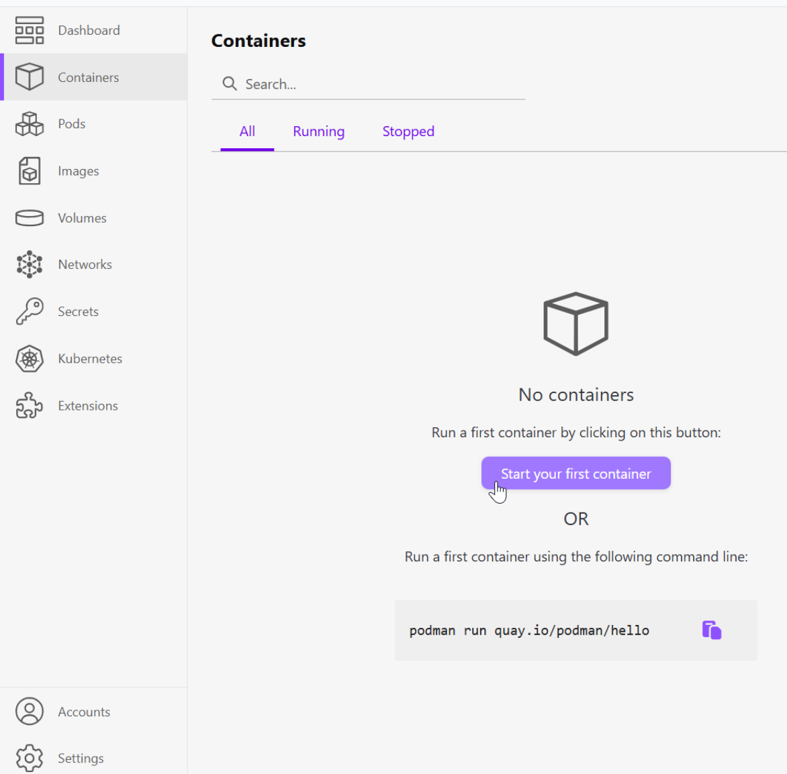

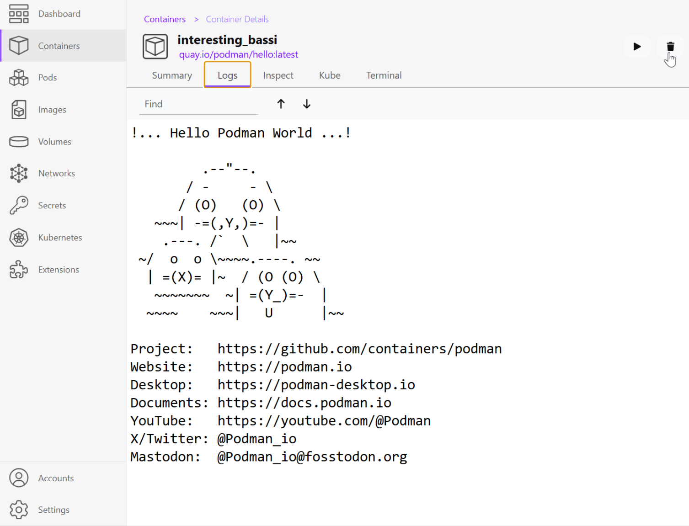
