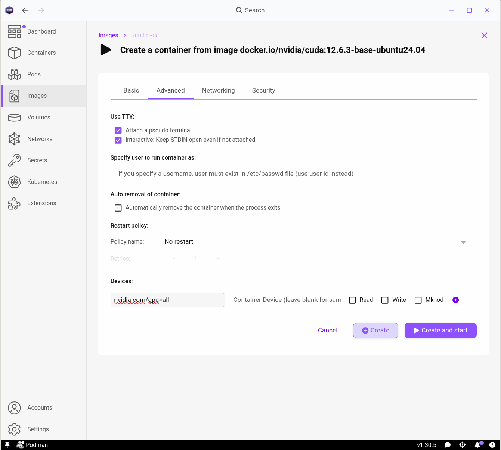

## Overview

When starting a container, there are three main parameters you may
need to set for the software to interface with your system correctly:

- Network ports, for browser access
- Storage mount points, for data access
- Device paths, for GPU use

We'll discuss each of these in turn.

::: {.callout-warning}
## Graphical applications

In this course we focus on applications that run from the command line or are
used through a web browser. Running graphical (GUI) applications in containers
is possible, but needs extra setup that varies by operating system, and is
beyond the scope of this course.
:::

## Network ports

A *port* is a numbered endpoint that a program uses to send and receive network
traffic. A running container is given its own virtual network by Podman which,
by default, is not reachable from your own computer. To reach a web
server running on port `80` inside the container, for example, that port must
be connected to a port on your own computer. This is referred to as
'publishing' a port, and ensures that traffic sent to the port on your computer
is forwarded to the connected port inside the container, and vice versa.

Normally, Podman Desktop detects the ports the container needs published
and automatically sets up the port mapping when you create a container.
If you try to create another container from the `01-container-demo` image,
you will see that the *Create a container from image...* page has
port `80` (the nginx web server inside the container) mapped to port `9000`
on your computer. This is why opening `localhost:9000` in your browser reached
the web server. A higher host port is a safer choice than `80`, since another
program may already be using `80`, and low port numbers can be restricted for
ordinary users. If you change `9000`, for example to `9500`,
the web page will be found at the new port instead. This may be necessary if you
know another application on your computer is already using `9000`.


## Storage

As discussed in [Container Concepts](concepts.qmd), containers have their own
filesystem. To work with your own data,
you can give a container access to a particular location (known as a *path*) on
your filesystem. This is called a *bind mount*. It links a specific folder on
your computer to a folder in the container, so that changes to files made on
either side are visible on the other. Unlike data written to the container's
internal filesystem, the files persist after the container is stopped and deleted.

This is easy to do in Podman Desktop, using the *Volumes* section when
creating a container.  The location of your data on
your computer should be entered on the *left*, and the path it is to have in the container on
the *right* (see example below). The latter  is often
a free choice; `/data` is a sensible default.

::: {.callout-note collapse=true}
## Volumes and bind mounts in Podman Desktop

Podman Desktop labels bind mounts as 'Volumes' in its interface.
This can cause confusion since, in container terminology, a
*volume* is strictly storage
created and managed by the container runtime itself, 
which is useful when you need a container to have persistent
storage but not for that storage to be accessible from your computer's
filesystem.

Podman Desktop supports creating dedicated container volumes from
the *Volumes* pane, but we will not use them in this course, since for
working with your own data a bind mount is simpler.
:::

Let's try this with the `busybox` image. Create a new container called
`storage-demo` with the default command `sh`. Under *Volumes*, use the file
picker (folder icon) to select your `Downloads` directory, and in the right-hand box
enter `/data`.


<!-- TODO: test on Windows that a folder in the home directory can be mounted -->

Note that busybox, like most containers, has a Linux filesystem, where a
*forward* slash is used as a path separator and all absolute paths begin with `/`
(the root), unlike Windows, where they begin with a drive letter such as `C:\`.

Here the `Downloads` folder is mounted at `/data`. Start the container, then
from the *Containers* pane click the running container, open *Terminal* and run
`ls /data`. You will see the files that exist in your `Downloads` folder.

**N.B.** Your user account must have read and write permissions for any directory
you mount, otherwise the container will not be able to read or edit files.

::: {.callout-note collapse=true}
## Exercise: data sharing

Create a text file `test.txt` in your `Downloads` folder, and check you can
view it from within the container using `cat /data/test.txt`. Can you do the
reverse, creating a file in the container and finding it in `Downloads`?
:::

::: {.callout-tip}
## Check your understanding

1. Look up the most common ports likely to be used by a web app
2. What could be a potential downside or risk of using a bind mount?
:::

::: {.callout-note collapse=true}
## Answers

1. 80 (HTTP) and 443 (HTTPS) cover the majority of web traffic.
2. A bind mount makes a portion of your filesystem available inside a container,
   so a malicious container process could copy or damage your files. For this
   reason it is good practice to share no more than the smallest portion of
   the filesystem you need (e.g. `C:\Users\username\phd-data\dataset-5` rather
   than `C:\Users\username`).
:::

## GPU access (Optional)

Many scientific computations rely on, or can be accelerated by,
a Graphics Processing Unit (GPU). In this section we explain how to make a GPU
accessible to processes inside a container. This material is more advanced,
so if you don't expect to use GPUs in your own workflow, you can skip directly
to [Module 2](../02-building-and-publishing/index.qmd).

Below we assume a Linux machine with an NVIDIA GPU, such as a shared research workstation or a
cloud virtual machine with a GPU attached. Other setups (Windows, macOS, and AMD
or Intel GPUs) are possible but beyond the scope of this course.
You can verify that the machine has an NVIDIA GPU by running
`nvidia-smi` from a terminal.

For Podman to use the NVIDIA GPU, the machine must have the [NVIDIA
Container Toolkit](https://docs.nvidia.com/datacenter/cloud-native/container-toolkit/latest/install-guide.html)
installed, and a Container Device Interface (CDI) file must have been generated.
You can confirm both by running:

```bash
nvidia-ctk cdi list
```

which should give output similar to:

```
INFO[0000] Found 3 CDI devices
nvidia.com/gpu=0
nvidia.com/gpu=GPU-7ad685a2-07bb-0ded-b5f5-20fbbf7aaaba
nvidia.com/gpu=all
```

If the command is not found, or lists no devices, ask a system administrator to
install the toolkit and generate the CDI file
(`sudo nvidia-ctk cdi generate --output=/etc/cdi/nvidia.yaml`).

To try GPU passthrough, go to the Images pane and Pull
`docker.io/nvidia/cuda:12.6.3-base-ubuntu24.04` in Podman Desktop. Create a
container named `gpu-demo` with the command `sleep infinity`, which will keep
the container running until it you stop it. Switch to the *Advanced* tab and,
in the left-hand *Devices* field,
enter `nvidia.com/gpu=all` exactly. You do not need to fill in the right-hand
field or edit any of the checkboxes. Start the container, click on its entry in
the Container list and go to
*Terminal*. If everything worked, running `nvidia-smi` here will give the same
output as when the command is run outside a container.




::: {.callout-note collapse=true}
## Why `sleep infinity`?

There appears to be a bug in Podman Desktop: the *Use TTY* option (under
*Advanced*) is not respected when adding a GPU under *Devices*.
It is therefore necessary to use a command that runs indefinitely to keep the
container open, unlike in our earlier busybox examples.
:::

#### Cleanup
As the Nvidia Cuda image is quite large (230MB), we recommend deleting both the
`cuda-demo` container and the image before moving on.


