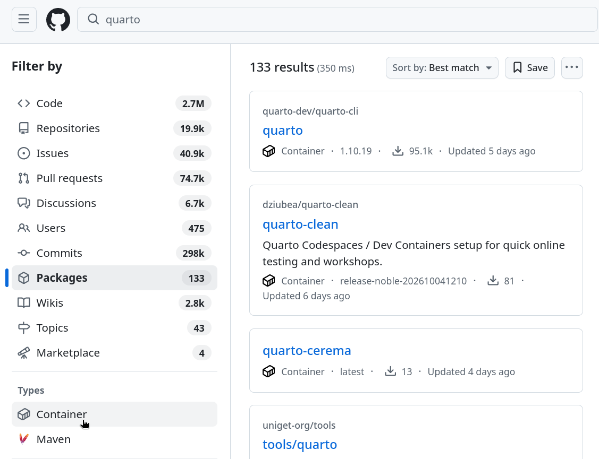
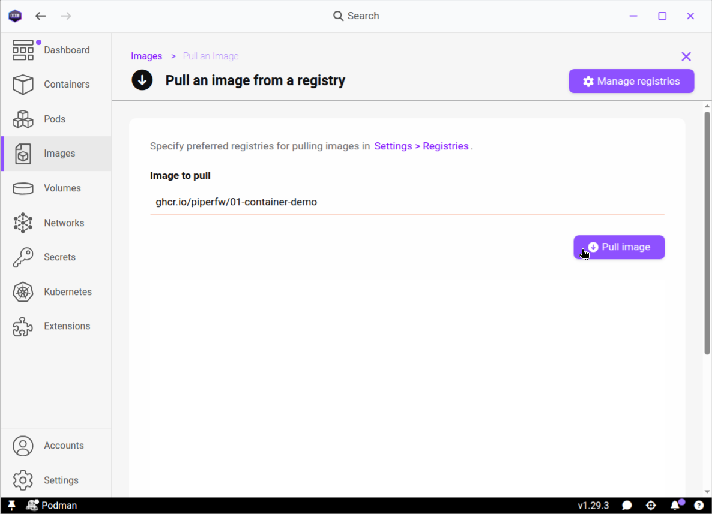
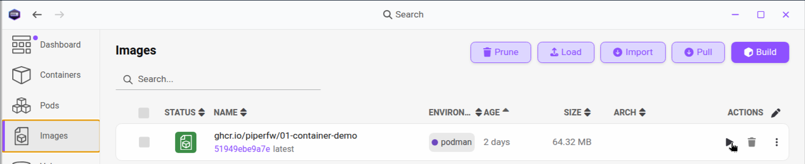
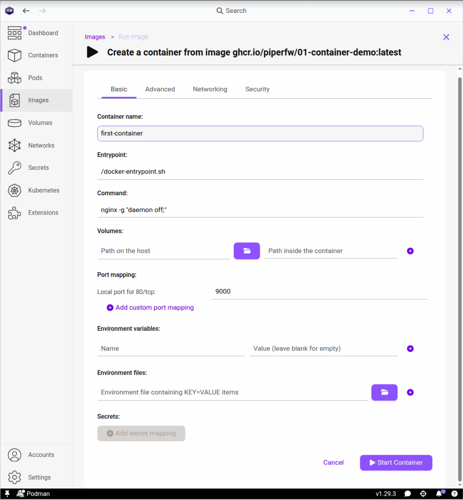
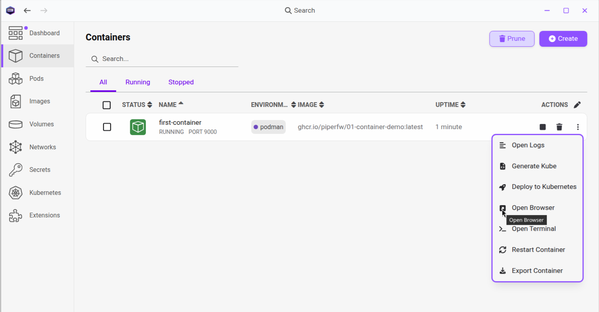
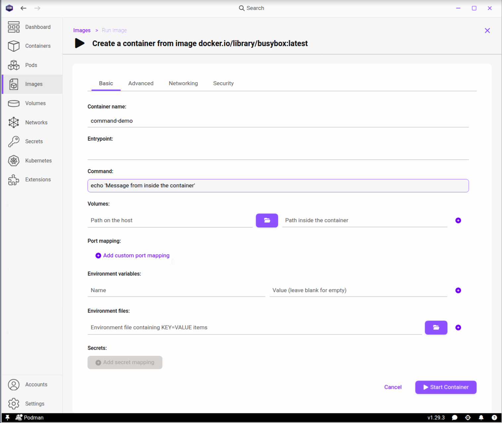
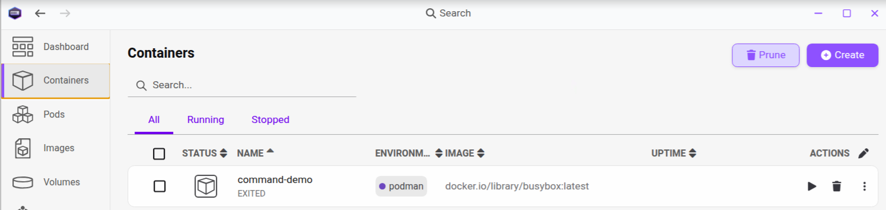

## Finding container images
Now that we have a grasp of the technology underlying containers, we can jump
right to finding and running a container image.

There are essentially two cases to cover if you want to run software in a container: 
(i), an image is already available on a public
registry or (ii), an image is not available. In the latter case you can
consider building an image yourself,
which is the subject of  [Module 2: Building Containers](../02-building-and-publishing/index.qmd).
Hence for the rest of this module we assume a container image already exists for
the software we want to use.

Three of the main registries hosting container images are:

- [Docker Hub](https://hub.docker.com), `docker.io`
- Red Hat's [`quay.io`](https://quay.io/search)
- The GitHub Container Registry, `ghcr.io`, from [GitHub](https://github.com/)

Of these, Docker Hub has the most features in terms of presenting a curated
library of software containers, although all three allow for searching. In
particular on GitHub, which is often used by researchers to host code
repositories, you can use the site-wide search bar and then select results matching
*Packages* and *Type: Container*.



With these sources, you can now ask whether a container image is available
for software you wish to use.
<!--before resorting to manual installation steps. -->
In many cases, if an image exists
it will be advertised in any online documentation the software may have,
and quite possibly recommended as the easiest way to get started with the software.

::: {.callout-tip collapse=true}
## Preferred Sources in Podman Desktop

Under *Settings > Registries* you can enter `docker.io,quay.io,ghcr.io` to 
indicate preferred sources for registries. Unfortunately, direct searching
for `ghcr.io` is not supported, so unlike `docker.io` and `quay.io`, you will
not see results for `ghcr.io` returned when searching for images, and must 
always specified a fully qualified name (e.g.,
`ghcr.io/piperfw/01-container-demo`).
:::

## Pulling an image

To put this into practice, we'll use a small image called `01-container-demo`
that was published on `ghcr.io` for this course. If you want to inspect it
online, you can find it using [this search](https://github.com/search?q=01-container-demo&type=registrypackages).

To load this image in Podman Desktop, go to the *Images* pane and press the
button labelled *Pull*, which in the context of software delievery is a
download operation. Enter `ghcr.io/piperfw/01-container-demo`. Here
`ghcr.io` is the registry (cf., `quay.io`, `docker.io`), `piperfw` the owner
and `01-container-demo` the name of the image. Press *Pull Image*.



You will see a progress bar for the download. Once complete, the image will
appear in the list on the *Images* page.

::: {.callout-tip collapse=true}
## Private images

You can pull any public container image without authentication. If you or your
organisation has a *private* image however, in order to retrieve it you will
need to enter your credentials under *Settings > Registries*. This is covered in
detail in [Module 2/Registry
Authentication](../02-building-and-publishing/registry-login.qmd).
:::

## Running an image

Now that Podman has the image stored locally, we can create our first container
from it. Staying in the Images tab, press the play icon on the right end of the
`01-container-demo` image box to reach the *Create a container from...* page.
This is prepopulated with a number of defaults that Podman fills in.
For now, just enter a memorable name like `first-container` and then press
*Start container*.

::: {.callout-warning collapse=true}
## Allowed container names

Podman restricts container names to letters, numbers, underscores hyphens 
and periods (`-._`). In particular, if you include spaces in the
name you will get an error when trying to start the container.
:::





Congratulations! You've created a container from a public image. So why didn't anything appear to happen?
`01-container-demo` is actually a tiny web server (nginx).
No graphical application
popped up because the web server runs silently in the background. To access it,
go to the *Containers* tab, where you should see your `first-container`
running. Click the three dots on the right-hand side of the container box and
*Open browser*. This will open 
our course demo web application, a simple single-page website, in your default
web browser.




::: {.callout-tip collapse=true}
## Pull and run

You can pull an image and immediately create a container from the Containers
tab. Just click `+Create` and select 'use existing image'. If the image 
doesn't already exist locally, the *Run* option will become *Pull and run*, and
Podman will pull it and add it to your image
list before starting the container.
:::

## Removing a container

Containers will continue running in the background, regardless of
whether you close the Podman Desktop app. They stop only when the command they
execute finishes (see below), you explicitly stop them, or the underlying Podman machine
is terminated. It is important therefore that you
keep on top of what containers you leave running, so as not to use up
unnecessary resources.

To stop a container, you have two options. Pressing the Stop icon just stops the
container, leaving the possibility of it being restarted in the future. On the
other hand, the delete button will stop and remove the container from the
filesystem, including any data or settings that you may have saved or configured
for that container.  In our case, it was a web app with no persistence expected
(the only configuration we made was the name), so you can go ahead and delete it.

::: {.callout-tip collapse=true}
## Removing images

Note that deleting a container does *not* automatically delete the image you
downloaded, which will still take up space on the local filesystem. The
`01-container-demo` image was only 65 MiB, but container images can be many GBs,
and so it's a good idea to remove those you no longer need.
:::

## Entrypoints and commands

Two features dictate the startup behaviour of a container from an image. 
The *entrypoint* is an executable that runs every time the container
starts, and a *command* defines the default arguments passed to it. Together they
form the full startup instruction.

For `01-container-demo`, the entrypoint is a script in the image called
`docker-entrypoint.sh`, and the command is `nginx -g "daemon off;"`, responsible
for starting the web server itself. The latter is a process that runs indefinitely unless
it is killed.

Many images do not define an entrypoint, only a command. In that case the command is
simply run directly as the container's main program.

Importantly, both entrypoint and command can be overridden, giving you the flexibility to change
the startup behaviour of an application. For a simple demonstration, we are
going to use the `busybox` image, which is a tiny (~5 MB) image available on
Docker Hub that contains a minimal Linux shell and common utilities, often used
for testing and debugging.

Return to the Images pane and pull `docker.io/library/busybox`. Using the
play icon on the image that is downloaded, create a container 
with the name `command-demo`. You will notice that there is no
default entrypoint and the command is `sh`, which is a Linux shell (terminal).
Let's try replacing it with a command to print a message,
`echo 'Message from inside the container'`:



Press start and go back out to the Containers pane. You will see that the
container you just created exited immediately. What happened? Since our command
was a one-shot command, not an ongoing process, it just executed and then immediately exited.



To see the output of the command that was run, click on the container and
navigate to *Logs*. This should confirm the message we passed to `echo`.


## Interactive containers

Now let's create another busybox container, named `sh-demo`, this time leaving the
default `sh` command. The shell is a persistent process, so the container won't
exit on its own..

With the `sh-demo` container you just created, click on the running container and
go to *Terminal*. This is a shell inside the container. Try the following:

```bash
ls
whoami
uname -a
```

- `ls` lists the files and folders in the current directory. This is the
  container's own filesystem, not that of your computer.
- `whoami` prints the name of the user running the shell. In this container it is
  `root`, the administrator account *inside* the container.
- `uname -a` prints system information, including the container's hostname
  (which defaults to the container ID set by Podman), as well as the kernel's
  name (`Linux`) and version (e.g., `6.8.0-146-generic`).

As a reminder from [Container Concepts](concepts.qmd), the kernel reported
by `uname -a` is the *host's* kernel (or, on Windows and
macOS, that of the Podman machine), rather than a new kernel belonging to the
container.


::: {.callout-tip collapse=true}
## Commands inside a container

Executing commands inside a running container is a very useful feature,
for example, to troubleshoot why an application is breaking or to edit
an application preference file.
:::

::: {.callout-note collapse=true}
## Exercise - Interaction and entrypoint inspection

Create a new container from the `01-container-demo` image, named `inspect-demo`.
Open its *Terminal* and look at the `docker-entrypoint.sh` script
(for example with `cat /docker-entrypoint.sh`). How does it control the
startup of the nginx web server?
:::

## Cleaning up

As mentioned above,  containers and images you no longer need take up system 
resources or storage space, so it is good practice
to remove them. From the *Containers* pane, delete `command-demo`, `sh-demo` and
`inspect-demo`, then from the *Images* pane remove the `busybox` and
`01-container-demo` images. This is optional, and you may prefer to keep
anything you plan to reuse.

In the next lesson, we will look at how containers can interface with your computer
with network ports, data volumes and GPU access.
