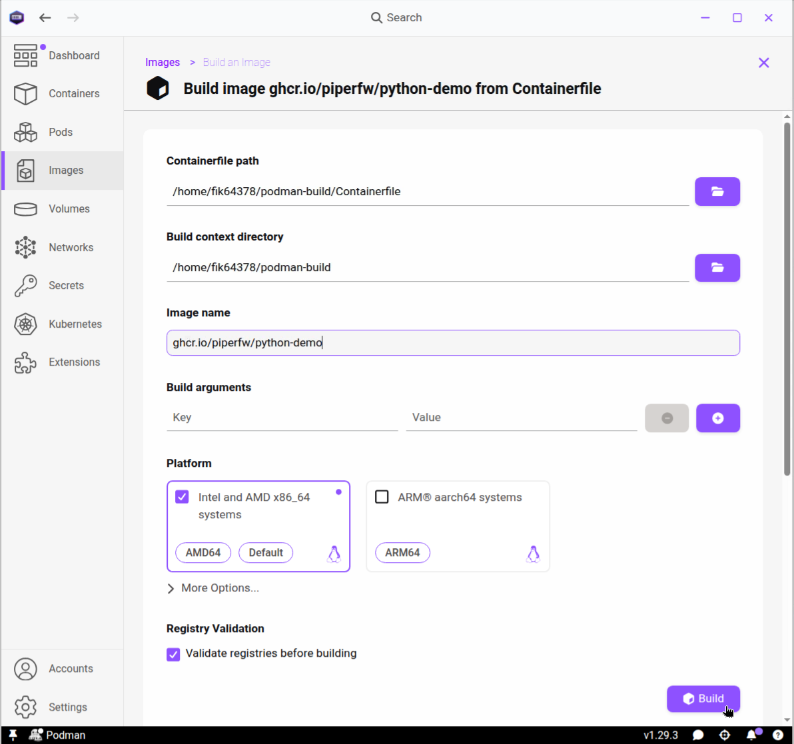
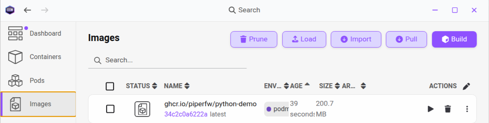
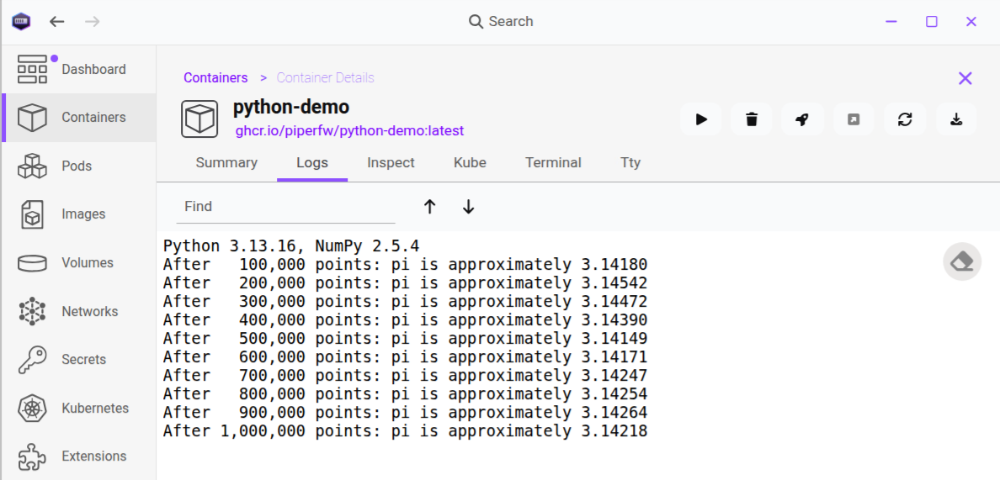

## The structure of a Containerfile

To assemble a container image, Podman reads instructions from a text file with a
particular syntax called a `Containerfile`. The syntax matches that used by
Docker, and the file may equally be named `Dockerfile`. Broadly, a Containerfile
starts from a *base image* that provides an operating system, and then runs
*instructions* that:

- Install dependencies and required libraries
- Add application software
- Configure the environment the application runs in
- Launches the target application with any desired parameters

Each 'instruction' is a line beginning with a keyword in capital letters, such as
`FROM` or `RUN`, followed by arguments for that command. Lines beginning with `#` are comments and,
together with empty lines, are ignored. To give you an idea,
a short example installing and using the `numpy` Python package is:

```dockerfile
FROM python:3.13-slim

RUN pip install numpy

CMD ["python", "-c", "import numpy; print(numpy.__version__)"]
```

::: {.callout-warning collapse=true}
## No inline comments

Inline comments are not supported. For example, in
```dockerfile
FROM python:3.13-slim # Base image
```
`# Base image` would  be read as extra arguments to `FROM`, and
the build would fail.
:::

## Build context

To build an image, you specify a working directory (folder) for Podman referred
to as the *build context*, which normally includes the `Containerfile`.
Podman's builder cannot see outside of this
directory, so any files or data you want to include in the image must be
either in this build directory or a subdirectory of it. On the other hand, you
can create a `.containerignore` file in the build directory to exclude
unnecessary files from the build context such as `.git`. However, this 
isn't necessary in most cases since files are not copied to the image
unless you explicitly write an instruction to that effect.


## Base images

The first decision you need to make when creating a container image is 
which base image to start from. Most containers you will encounter use
some flavour of Linux, since this is the de facto operating system for 
software containers.
In general you want the smallest image
that supports your application, since smaller images are downloaded faster 
and have less exposure to security vulnerabilities.

Commonly used base images into one of following categories:

- Minimal images, like Alpine and BusyBox, which are small and fast (~5MB),
  but require you to install almost everything yourself
- Full operating system images, like Ubuntu (~40MB) and Debian (~50MB), which are good
  general-purpose starting points
- Language-specific images, such as `python:3.13` or `r-base` (~400MB), which
  have a programming language installed on-top of Debian or similar image
- An existing image of a particular application, if you want to extend the
  image's behaviour to suit your needs

For scientific software, the language-specific base images are often a sensible
choice. Below we write a Containerfile using the `python:3.13-slim` image, which
is a minified version (~40MB) of the Python image, build on Debian.
Before doing so, we explain the purpose
of the most common instructions you are likely to need,
following Docker's [Dockerfile reference](https://docs.docker.com/reference/dockerfile/),
which defines the standard used by both Docker and Podman.

## Containerfile instructions 

### `FROM`

This sets the base image for the instructions that follow. The build processes
starts with `FROM`. For large or complex images, the build can be split into
several *stages* using multiple `FROM` instructions, with later stages able to
use files from earlier ones. For this course, `FROM` appears once, on the
first line.

### `RUN`

This runs a command and saves the result in the
image. It is the most common instruction. For example, you can `RUN pip install`
to add a Python package, or `RUN curl` to download source files. In the form we
use, the command runs in the image's default shell.

### `COPY`

This copies files from your computer, such as your application code, into the
image. Paths are relative to the build context (see above). It can also
copy files from other build stages or images, although we will not make use
of that feature.

### `WORKDIR`

This sets the working directory for the instructions that follow, and for the
container when it runs. If the directory does not exist, it is created.

### `ENV`

This sets an environment variable, a named setting that programs can read. Unlike
`RUN`, its effect persists into the running container as well as later build
steps. The `ARG` instruction can be used to set variables for the build only.

### `CMD` and `ENTRYPOINT`

These correspond to the *command* and *entrypoint* you saw in Podman Desktop in
[Running Containers I](../01-introduction/running-containers.qmd). The
entrypoint is an optional executable that runs every time the container starts.
`CMD` gives the default command, or the default arguments passed to the
entrypoint if there is one. Both are usually written as a list in square
brackets, for example `CMD ["python", "script.py"]`, so the program runs directly.

Some additional instructions, such as `LABEL` and `USER`, are covered in
[Reproducible Builds](reproducible-builds.qmd) and
[Best Practices](../03-automation-and-best-practice/best-practices.qmd).

## Writing the Containerfile

To put the above into practice, we will containerise a small Python script.
You are encouraged to use a script of your own if you have one to hand. For
simplicity, we recommend a linear program that prints its results directly
(rather than saving them to file). Otherwise, you can use the demo script below,
which estimates π by random sampling.

First, create a new directory, called `podman-build` say. Place a copy of your
script at `podman-build/script.py`, or create the file with the following
contents:
```python
import sys
import numpy as np

rng = np.random.default_rng()
batch_size = 100_000 # points per iteration  
inside = 0
total = 0

print(f"Python {sys.version.split()[0]}, NumPy {np.__version__}")
for batch in range(10):
    points = rng.random((batch_size, 2))
    inside += np.count_nonzero(np.sum(points**2, axis=1) <= 1)
    total += batch_size
    print(f"After {total:>9,} points: "
		  f"pi is approximately {4 * inside / total:.5f}")
```
Those with a science or maths background may recognise that this script
uses a Monte Carlo method to calculate increasingly accurate estimates of
π.

Alongside `script.py`, create a `requirements.txt` file
listing packages to
be installed via `pip`. For the above example, this is simply
```bash
numpy
```
If you're using your own script, make sure to list all the Python packages
it requires here.

We now come to the `Containerfile` itself. Create a file with this name
and no extension in the same directory. 

::: {.callout-tip}
## Follow along

We recommend typing out each command below manually, especially
if you are using your own script. A complete copy of the Containerfile for the
demo script is included at the end of this section, in case you are struggling
to find a typo in your own.
:::

We start with the `python:3.13-slim` base image. You shouldn't need to change
this, unless your own script is not compatible with Python 3.13, in which case
you can choose another tag from the
[official Python image](https://hub.docker.com/_/python).
```dockerfile
FROM python:3.13-slim
```

Next, we set `PYTHONUNBUFFERED=1`, which forces Python to print output without
delay. This is useful when testing in containers to ensure immediate
feedback, although the
demo script above will run so quickly it will not make a noticeable difference
in that case. We also change the working directory to `/app`:

```dockerfile
ENV PYTHONUNBUFFERED=1
WORKDIR /app
```

As `/app` does not exist in the `python:3.13-slim`, it will be created.

Next, we install the dependencies by copying the requirements file and
performing a pip install:

```dockerfile
COPY requirements.txt .
RUN pip install --no-cache-dir -r requirements.txt
```
The `--no-cache-dir` option tells `pip` not to keep a cache of downloaded
packages, which keeps the image smaller. If you needed to install system
packages instead, you would use a `RUN` instruction with the base image's
package manager, such as `apt install` on a Debian-based image such as
`python:3.13-slim`.

The `COPY` operation has the syntax `COPY <src> <dest>`, where `<src>`
refers to a location in the build context&mdash;in this case  `podman-build`&mdash;and
`<dest>` a location relative to the container's current working directory,
`/app`.
In particular, `.` is short-hand for the current directory, which we set to
`/app/`, therefore
`requirements.txt` is copied to `/app/requirements.txt`.

We similarly copy the script to `/app`:
```dockerfile
COPY script.py .
```

Finally, we set `python script.py` as the default command to be run by the
container
```dockerfile
CMD ["python", "script.py"]
```

::: {.callout-note collapse=true}
## Complete Containerfile

```dockerfile
FROM python:3.13-slim

ENV PYTHONUNBUFFERED=1
WORKDIR /app

COPY requirements.txt .
RUN pip install --no-cache-dir -r requirements.txt

COPY script.py .

CMD ["python", "script.py"]
```
:::


## Building the image

In Podman Desktop, go to  *Images* and press *Build*. For *Containerfile path*, select the
`Containerfile` you created. The build context directory should be filled in
automatically; check that it is the directory containing `Containerfile`,
`script.py` and `requirements.txt`

Since we will publish the image shortly, it is useful to give it a fully
qualified name now, although it's possible to change an image's name after creation if you forget to.
Enter `ghcr.io/username/python-demo`, replacing `username` with your GitHub
username in lowercase. You can edit `python-demo` if there is a more
appropriate name for your application. Leave the default *Platform* setting.

Press *Build*. A log page will appear showing 
each instruction running. Once the build succeeds, the image will appear in Podman's *Images*
list.





## Testing the image

Start a container from the image you just created by pressing the play icon on its entry,
entering a container name (optional) and selecting  *Start container*.
If successful, the container will run the script immediately and exit,
similar to the busybox `echo` example we covered in [Module
1/Running Containers I](../01-introduction/running-containers.qmd).

Open the container and view the *Logs*. If you used the Monte Carlo program above,
you should see a printout of the Python and NumPy versions, followed by
estimates approaching π. 


