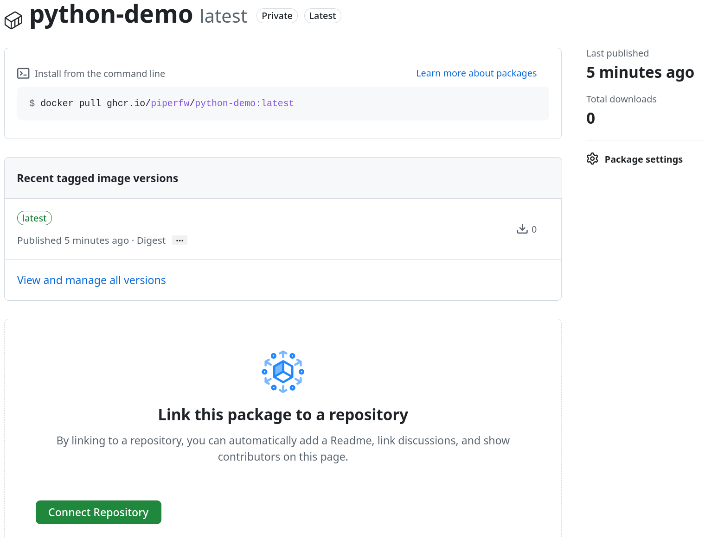

## Overview

Publishing images on a public registry allows others to find and download your
containerised software. Some registries also allow private images, which can
be used for personal projects or collaborative
projects within an organisation. In this lesson we push to
GitHub's `ghcr.io`, where new container images, referred to as *Packages*, are
private by default.

::: {.callout-warning collapse=true}
## Docker Hub and Quay.io private limits

Pushing to Docker's `docker.io` creates a *public* image by default. You can
change the default visibility in your account settings, but free accounts are
only allowed a single private repository. Quay.io, on the other hand, makes new
images private by default, but free accounts cannot keep private repositories.
:::

## Image tags

When browsing Docker Hub or GitHub packages, you may have noticed different
*tags* being specified for an image. Tags label different versions of a
container image, and are appended to the image name after a colon, as in
`registry.io/owner/image-name:tag`.

Tags can be descriptive, like `:devel` and `:nightly`, version numbers, like
`:v1.0` and `:3.13`, or, most often, a combination of both, like
`python:3.13-slim`, which is the minimal ('slim') image for Python 3.13.

Several tags can point to the same image, often with short tags being
abbreviations for more specific ones. For example, `python:3.13-slim` is updated over time to point to
the latest patch release of Python 3.13, meaning it actually resolves to
 `python:3.13.x-slim`, where `x` is a patch
number. A specific tag is therefore a more precise reference than a general one.
We return to this in [Reproducible Builds](reproducible-builds.qmd).

When pulling an image in Podman Desktop, you can append a `:tag` to the image
name to retrieve a particular version. Otherwise, the tag defaults to `:latest`.
This is also the default tag when building images. You can confirm it was
applied to the image you created in  [Building Containers](building.qmd) by
clicking on the built image, e.g., `python-demo`, in
the *Images* tab and reading *Tag* under *Summary*.

 with the `latest` tag.](assets/python-demo-info.png)

The tag of an image can be edited using the *Edit image* icon in the toolbar of
the image details view. We discuss how to choose tags in the next lesson; for
now it is fine to leave it as `latest`.

## Pushing an image

::: {.callout-important}
To push to `ghcr.io` you must have configured Podman Desktop with your username
and personal access token, as described in
[Registry Authentication](registry-login.qmd). Check that these are set for
GitHub under *Settings > Registries* before proceeding.
:::

In Podman Desktop, go to the *Images* pane, select
`ghcr.io/username/python-demo` (or whatever you called your image) and press the
*Push* (up arrow) icon. A pop-up will ask you to confirm the image name and
tag. Press *Push image* and, once the upload completes, *Done* to close the dialogue.

To check that your image was uploaded, go to your GitHub profile at
`github.com/username` and navigate to the *Packages* tab. You should see a new package, such
as `python-demo`, with a *Private* label to indicate that it is visible only to
you. Clicking on it shows more details, including the available tags (only
`latest` for now) and the last published date.

## Making an image public

To make your image public, and so complete the publication process, go to the
package page and open *Package settings* (cog icon). Near the bottom of the page
is an option to *Change visibility* from private to public. This is not required 
for the course, so it is up to you if you want to toggle the visibility or not.

::: {.callout-note collapse=true}
## Clean-up (optional)

We will use this package again later in the course. If you would 
like to remove the package now, you can do so by selecting *delete* under
'danger zone' from the
*Package Settings* page.
:::

As shown above the package page also presents the option to connect the package to an
existing repository. This is useful in the common case where you want to provide
a container build for software already hosted on GitHub. The package is then
shown alongside the repository's code. An example with the `python-demo` image can be seen at
[github.com/piperfw/podman-desktop-course](https://github.com/piperfw/podman-desktop-course).

Note that, if the repository is public, connecting the package to it will also make
the package public since, by default, new packages inherit access from their source
repository. You can change this behaviour in your GitHub account settings under
*Packages*,  by unticking *Inherit access from
source repository*. This applies to new packages only. For an existing package,
change its visibility on the package's own *Package settings* page.

::: {.callout-tip}
## Check your understanding

1. What is the difference between private and public visibility for a container
   image?
2. (Harder) What happens if you push the same image with a different tag?
:::

::: {.callout-note collapse=true}
## Answers

1. A public image can be found and downloaded by anyone, without authentication.
   A private image is accessible only to you, or to the people or organisation
   you have granted access to.
2. A new tag is added to the package, pointing at the same image. As the
   image content is unchanged, it is not uploaded again, and both tags
   refer to the same image. This is most common for
   the latest version number, e.g., `v1`, and the `latest` tag.
:::
