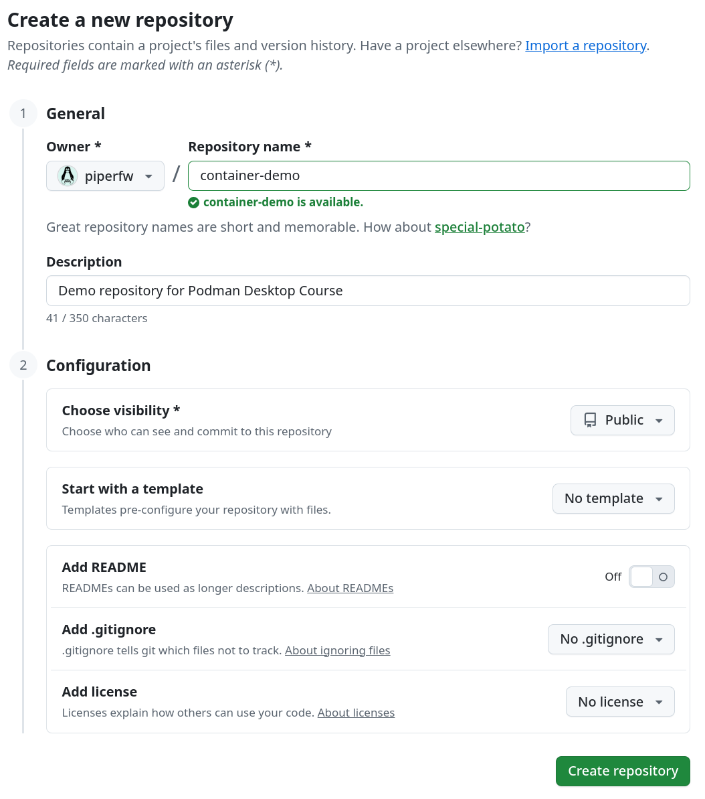
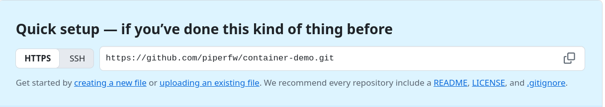

## Demo repository

In the previous module we built a container image for a small Python application
and pushed it to the GitHub Container Registry, `ghcr.io`, as a standalone
package. In most cases, however, you will want to publish your container image
alongside the source code in a repository. 

Below we create a
repository for our Python software on GitHub that will be used throughout this
module. This will allow us use GitHub's built-in workflow services to run jobs against our codebase
on-demand or in response to events such as new code being pushed. Those jobs will enact a build, test
and publish process for our container.

### Creating the repository

Create a new repository by logging in to GitHub and navigating to
[github.com/new](https://github.com/new). Name it `container-demo`, and optionally add
a description. You can set the visibility to
private or leave it public. Instructions for removing the repository will
be given at the end of the course. You can skip adding a README,
`.gitignore` or licence for now.




### Preparing the repository

The repository will need the `Containerfile`, `script.py` and `requirements.txt` for
`python-demo`. As before, you are welcome to use files for your own Python script.
If you completed the
exercise in [Module 2/Reproducible Builds](../02-building-and-publishing/reproducible-builds.qmd), you can upload
your updated files, including any `LABEL` instructions. Otherwise, copies
of the default files are given in full at the bottom of these page&mdash;you
can copy them into new files using GitHub's web interface (*Add file/+ >
Create new file*).

<!---->

Your repository should then look similar to:


## Repository files

::: {.callout-note collapse=true}
## `Containerfile`

```dockerfile
FROM python:3.13-slim

ENV PYTHONUNBUFFERED=1
WORKDIR /app

COPY requirements.txt .
RUN pip install --no-cache-dir -r requirements.txt

COPY script.py .

CMD ["python", "script.py"]

LABEL org.opencontainers.image.title="python-demo"
LABEL org.opencontainers.image.description="Demo Python app to estimate pi"
LABEL org.opencontainers.image.version="0.0.1"
LABEL org.opencontainers.image.authors="<name>"
LABEL org.opencontainers.image.source="https://github.com/username/repository-name"
LABEL org.opencontainers.image.licenses="MIT"
```
:::

::: {.callout-note collapse=true}
## `requirements.txt`

```bash
numpy==2.5.3
```
:::

::: {.callout-note collapse=true}
## `script.py`

```python
import sys
import numpy as np

rng = np.random.default_rng(seed=1)
batch_size = 100_000  # points per iteration
inside = 0
total = 0

print(f"Python {sys.version.split()[0]}, NumPy {np.__version__}")
for batch in range(10):
    points = rng.random((batch_size, 2))
    inside += np.count_nonzero(np.sum(points**2, axis=1) <= 1)
    total += batch_size
    print(f"After {total:>9,} points: "
          f"pi is approximately {4 * inside / total:.5f}")
```
:::
