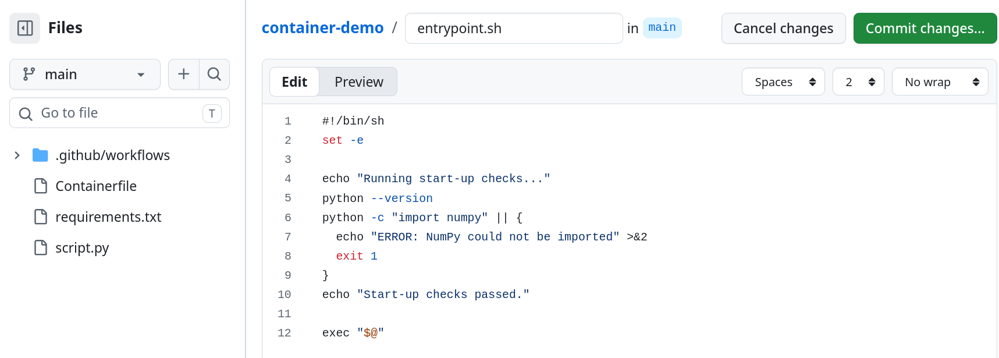

## Testing opportunities

Automated testing is an essential part of software development. It allows code
changes and functionality to be validated before release, at little cost. Most
unit and integration testing is done in a somewhat contrived way, against
portions of the codebase rather than a running instance of the software
itself. For example, `pytest` can be used to run parametrised tests
against the methods of backend service for a Python web application.

Container builds in CI/CD present the possibility of end-to-end
testing: by performing tests inside a container, you test a real instance of the
application as it would run when deployed. As the container environment is
reproducible, one can be reasonably confident that the image tested in CI behaves
like the one users will run.

However, running all tests inside a container is often impractical. Images of
large software can take a long time to build, so developers may have to wait
minutes or even hours for tests to complete, which slows the feedback loop and
discourages small, precise changes. Failures inside a container are also harder
to investigate, since test errors are nested in the container's output, and
reproducing a problem may require building locally and working inside an
instance of the container. Test tools and data must also be added to the image,
making it larger.

<!-- Further, many tools require human interaction to be operated/tested -->

A more balanced approach can be suggested:

1. Run unit and integration tests early in the workflow, before the container
   build
2. Build the container image only if those tests pass, to avoid unnecessary builds
3. Run a small set of tests against the built container, before publishing

Testing the software itself (step 1) was the subject of the previous course in
this series. Here we show how the other two steps can be implemented.
The type of tests we will consider for containers are startup tests.
These can be included in an entrypoint script, so that they have dual-purpose
in also providing installation checks for end users, confirming that the image has loaded
correctly on their system and with any configuration they may have provided.

## Conditional builds

In a complete workflow, codes tests should run in a separate job *before*
the job we created to build and publish our image. However, jobs in a GitHub workflow run in
*parallel* by default. 
To resolve this, we add a `needs` setting 
make for the container job to make it both wait for, and depend on, the success of code
tests:

```yaml
jobs:
  test:
    runs-on: ubuntu-24.04
    steps:
      - name: Run tests
        run: echo "No tests created yet"

  build-and-publish-container:
    needs: test
    runs-on: ubuntu-24.04
    permissions:
      packages: write
      contents: read
    steps:
      # ... existing steps
```

The `test` job is just a placeholder. In a real project it would involve
installing dependencies and running a test suite such as `pytest`,
as covered in the Testing course. Importantly, if *any* step in `test` fails,
`build-and-publish-container` never runs.

<!--
::: {.callout-note collapse=true}
## Fresh runners

Each job in a workflow gets its own runner, and runners do not share files or
permissions. This is why the `test` job needs its own checkout step.
:::
-->

In your repository, open the workflow file (`podman.yml`), add the dummy `test` job
and the `needs: test` line as above, then commit the changes and re-run the
workflow from the *Actions* tab. On the run page, you should see the `test` job
complete first, followed by the build and publish job.

::: {.callout-note collapse=true}
## Workflow name

Note the workflow will still appear as *Build and publish container image* in
the Actions interface. Update this as you please.
:::


## Startup tests

One of the simplest tests you can run on any software is that it runs at all.
This is sometimes called a *smoke test*. For containerised software, it means
running the container for a short time and catching any failures.

We add this as a step after the build but before publishing:

```yaml
      - name: Build image
        run: podman build -t python-demo:latest .
      - name: Smoke test image
        timeout-minutes: 2
        run: podman run python-demo:latest
      - name: Log in to GHCR
        run: echo "${{ secrets.GITHUB_TOKEN }}" | podman login ghcr.io -u ${{ github.actor }} --password-stdin
```

We expect the container to run the script and exit almost
immediately. If a bug in our script does cause the container to hang, `timeout-minutes: 2` instructs GitHub to
terminate the step after 2 minutes.

How does this stop a broken image from being published? Unlike jobs,
the steps within a job run in series, and GitHub only starts a step if the
previous one succeeded. In command line programs, success is indicated by an *exit code*:
`0` means a normal exit, and any other number indicates an *error*. When Podman
runs `python-demo`, if the script exits with a non-zero code, Podman returns the
same code, and GitHub recognises the failure and stops the job. Alternatively,
if the timeout is
reached, GitHub cancels the step and marks it as failed, so the job also stops.

Edit the workflow to add the new step, commit it and run the workflow again. If
the container runs successfully, the job continues to publish the image, and the
log for the smoke test step contains the script's output.


::: {.callout-note collapse=true}
## Complete workflow file
`.github/workflows/podman.yml`
```yaml
name: Build and publish container image
on: workflow_dispatch

jobs:
  test:
    runs-on: ubuntu-24.04
    steps:
      - name: Run tests
        run: echo "No tests created yet"
        
  build-and-publish-container:
    needs: test
    runs-on: ubuntu-24.04
    permissions:
      packages: write
      contents: read
    steps:
      - name: Checkout repository
        uses: actions/checkout@v6
      - name: Build image
        run: podman build -t python-demo:latest .
      - name: Smoke test image
        timeout-minutes: 2
        run: podman run python-demo:latest
      - name: Log in to GHCR
        run: echo "${{ secrets.GITHUB_TOKEN }}" | podman login ghcr.io -u ${{ github.actor }} --password-stdin
      - name: Tag and push
        run: |
          IMAGE=ghcr.io/${GITHUB_REPOSITORY,,}
          podman tag python-demo:latest "$IMAGE:latest"
          podman push "$IMAGE:latest"
```

:::


::: {.callout-tip collapse=true}
## Long-running software (advanced) 

Our demo finishes in seconds, but real software may be interactive or take hours
to run. In such cases, a program still running when the timeout is reached
should count as a *success*, since it started correctly. You could use a step
like this:

```yaml
      - name: Smoke test image
        run: |
          code=0
          timeout -k 10 30 podman run long-running-program:latest || code=$?
          if [ "$code" -eq 124 ] || [ "$code" -eq 137 ]; then
            echo "Still running at timeout, treating as success"
            exit 0
          elif [ "$code" -ne 0 ]; then
            echo "Container failed with exit code $code"
            exit "$code"
          fi
```

Here `timeout` is a Linux tool that runs a command with a time
limit. After 30 seconds it sends a terminate signal to the command and exits with code `124`. If
the program is still running 10 seconds later (`-k 10`), it is killed and the
exit code is `137`. Both cases are translated to `0`, so that GitHub treats the
start-up test as passed and continues.
:::

## Entrypoint tests

To test the operation of a application in a container, one could attempt to parse its output
in the CI logs. This cannot really be considered a reliable testing strategy
however due to the fragility limited scalability of pattern matching.
An alternative is to put tests in the container's entrypoint,
which, as you will recall from
[Module 1/Running Containers I](../01-introduction/running-containers.qmd), runs every time
the container starts. It can therefore check that the environment is as expected,
before handing over to the application.

This approach has the benefit that the checks run not only in CI, but also for
anyone running your image, so they can warn about configuration problems that
would otherwise surprise or confuse a user. It is also the main trade-off: you
do *not* want many or long checks in the entrypoint (for example benchmarking),
since they slow the startup of the application for the user.

::: {.callout-tip collapse=true}
## Skipping the entrypoint

Users who want the quickest start-up can bypass your entrypoint script by
overriding it when they run the container, for example by clearing the *Entrypoint* field 
in the *Create a container from...* in Podman Desktop.
:::

Here are just a few things you could check in the environment:

- the Python version matches expectations
- a mandatory dataset, input file or argument was provided by the user
- expected commands exist and can be run (e.g., test `command --help`)
- the system path for executables (`$PATH`) is set correctly
- a GPU is accessible, for a program that requires one
- the filesystem is writeable, for a program that writes output files
- a network connection is available, for a program that needs web access

To illustrate this idea, we include a check that confirms Python is installed and
NumPy can be imported, and stops with a clear message if not. In the GitHub web
interface, create a new file in the root of your repository called
`entrypoint.sh`:

```bash
#!/bin/sh
set -e

echo "Running start-up checks..."
python --version
python -c "import numpy" || {
  echo "ERROR: NumPy could not be imported" >&2
  exit 1
}
echo "Start-up checks passed."

exec "$@"
```

This is a *shell script*, a text file of terminal commands that run in order. You
are not expected to know shell scripting for this course. Briefly, `set -e` stops
the script at the first error, and the check prints a message and exits with a
non-zero code if NumPy cannot be imported.

The final line, `exec "$@"`, executes whatever command was passed to the script,
which is `CMD` from the `Containerfile` or any override the user provided. 
This is important because a user who specifies a command at
start-up will still have it run, as in [Module 1](../01-introduction/running-containers.qmd)
when we replaced `sh` with `echo` for busybox.



Next, edit the `Containerfile` to copy the new script and set it as the entrypoint.
Replace the existing `COPY script.py .` and `CMD` lines with:

```dockerfile
COPY script.py entrypoint.sh ./
RUN chmod +x entrypoint.sh

ENTRYPOINT ["/app/entrypoint.sh"]
CMD ["python", "script.py"]
```

::: {.callout-note collapse=true}
## Updated Containerfile
```dockerfile
FROM python:3.13-slim

ENV PYTHONUNBUFFERED=1
WORKDIR /app

COPY requirements.txt .
RUN pip install --no-cache-dir -r requirements.txt

COPY script.py entrypoint.sh ./
RUN chmod +x entrypoint.sh

ENTRYPOINT ["/app/entrypoint.sh"]
CMD ["python", "script.py"]
```
:::

The `chmod` command marks `entrypoint.sh` as executable, which is a necessary
step for it to be run as a bash script on Linux. Commit both files and run the
workflow again. The log for the smoke test step now begins with the start-up
checks, followed by the script's output. The same checks would appear if you now pulled and
run the image in Podman Desktop.


::: {.callout-tip collapse=true}
## Exercise: failing check

To see a failing check, change `import numpy` in `entrypoint.sh` to
`import pandas` and edit the failure message to refer to Pandas.
 Commit the change and run
the workflow. Since `pandas` is not installed, the startup step will fail with your error message, and the
workflow stops before publishing. Revert the change afterwards.
:::
