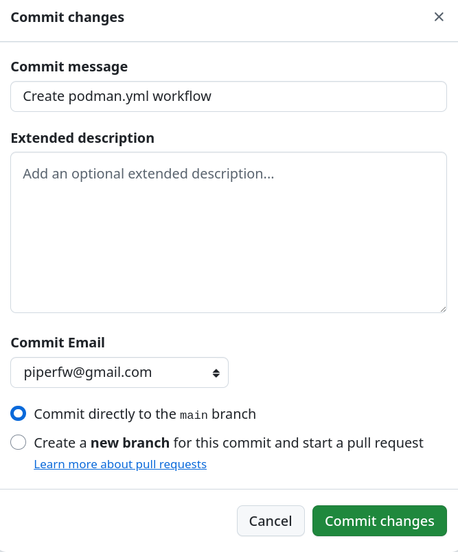
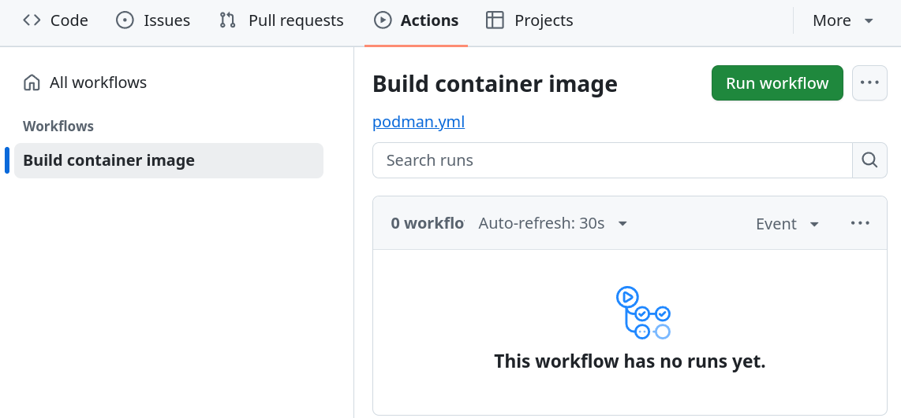

## Overview 

A GitHub Workflow is a computational pipeline that runs automatically when
a chosen event occurs in a repository. In this lesson we will build up a
template workflow for building and publishing a container image that you
can adapt for your own repositories. 

::: {.callout-note collapse=true}
## How much do I need to know?

Authoring workflows is a vast topic, since they are flexible enough to handle
build, test and publication processes for many different types of software.
For most people, however, being able to read a workflow and understand its basic
components is sufficient. Any common task, such as creating a Python package or
building a container, will have numerous examples in use by public repositories.
GitHub also provides a number of workflow templates, and a marketplace of community-written actions
that simplify complex tasks.

For a good introduction, see GitHub's documentation on
[workflows](https://docs.github.com/en/actions/concepts/workflows-and-actions/workflows).
:::

## Workflow components

Workflows are defined by YAML text files (`.yml` or `.yaml`)  placed in a specific
directory, `.github/workflows/`, which GitHub scans. A workflow has three
essential top-level components:

- `name`, to identify or briefly describe the workflow
- `on`, to define events that trigger the workflow (e.g., a push to a
  branch, or a pull request)
- `jobs`, which define the processing steps to be run

A workflow can have mulptiple jobs, each associated with a particular task, such as
running tests or creating a container image. Jobs are executed on cloud
computers hosted by GitHub called *runners*.

Runners have no Podman Desktop, so our workflows use the Podman command line
interface (CLI) instead. You do not need to memorise the commands used and we will point out how each one
maps onto the Podman Desktop actions used in the previous modules.

We'll start by creating a workflow that is run manually, i.e., on demand, with a
single job that builds a container image using Podman.

::: {.callout-note collapse=true}
## What is YAML?

YAML is a text format made of key-value pairs separated by a colon, as in
`key: value`. Structured values are built using indentation (with spaces, never
tabs). For example:

```yaml
people:
  - name: user1
    email: user1@example.com
  - name: user2
    email: user2@example.com
```

defines a list called `people`, where each person has a `name` and an `email`.
You don't need to be proficient at writing YAML to implement our workflow,
but the Common Workflow Language project has
a thorough [guide](https://www.commonwl.org/user_guide/topics/yaml-guide.html)
if you want to learn more after the course.
:::

## Build-container

Go to the repository you created in [Preparing a Repository](repository.qmd) and
click the *Add file (+)* button. In the filename box at the top, type
`.github/workflows/podman.yml`. This creates the `.github/workflows` directory
and a file called `podman.yml` inside it. The name of the file does not matter,
but the directories must be exactly `.github/workflows`.


At the top of the file, enter:

```yaml
name: Build container image
on: workflow_dispatch
jobs:
  build-container:
    runs-on: ubuntu-24.04
```
Be careful to input two spaces (or one Tab) for successive
levels of indentation. The GitHub editor  provides Tab-competition
of commands to support writing the definition by hand.

The first line above gives the workflow a
name, and `workflow_dispatch` sets it up to be triggered manually.
A single job, `build-container`, is defined and assigned to
Linux runner using Ubuntu 24.04.

Next add the *steps* that make up the job:

```yaml
  build-container:
    runs-on: ubuntu-24.04
    steps:
      - name: Checkout repository
        uses: actions/checkout@v6
      - name: Build image
        run: podman build -t python-demo:latest .
      - name: Verify image
        run: podman images
```

A step either uses a reusable, pre-written *action* (`uses`) or runs a shell
command (`run`). The first step uses `actions/checkout@v6`, an action that
copies the repository's files onto the runner. This is almost always the first
step of a job.

The second step calls Podman CLI to build the image. It is the
equivalent of the *Build* page in Podman Desktop: `-t` sets the name and tag of
the image (`latest` for now), and `.`  sets the build context to the current
working directory, which is the root of the
repository and includes `Containerfile`. The final step lists the images known
to Podman, like the *Images* pane in Podman Desktop, so that we can confirm that the
build worked.

Once you have added the above, press *Commit changes* to commit the file to the
`main` branch.

{width=50%}

After committing the changes, go to the *Actions* tab in the GitHub toolbar and select the *Build
container image* workflow we just created. Because we set the `workflow_dispatch`
trigger, you can run it manually from here. Do so now.



You will be brought to a page showing the progress of the workflow. Once it is
complete, a green tick is displayed. Click on the `build-container` job to view
the logs, including the *Verify image* step, which should list the `python-demo`
image.

## Build-and-publish-container

So far the image is built on the runner but never placed anywhere, and the
runner is discarded when the job ends. For simplicity, we will extend the current
job to publish the image, renaming it `build-and-publish-container`.

Navigate back to the `podman.yml` workflow file and press the Pencil icon
to edit the flow. Let's firstly update the name of the workflow and job:
```yaml
name: Build and publich container image
on: workflow_dispatch
jobs:
  build-and-publish-container:
    runs-on: ubuntu-latest
    steps:
```

In order for the runner to upload a package to `ghcr.io`, it
must have write permissions to GitHub packages. These permissions
can be granted at the job level:
```yaml
jobs:
  build-and-publish-container:
    runs-on: ubuntu-24.04
    permissions:
      packages: write
      contents: read
```
We also defined `contents: read` to allow the runner access to the repository
contents, which is a common default for GitHub workflows but worth making
explicit.

Next, we need to add a step authenticating Podman on the runner with `ghcr.io`,
just as we configured GitHub under *Settings > Registries* in Podman Desktop. 
Unlike in [Module 2](../02-building-and-publishing/index.qmd), we do not need to create an
access token, since
GitHub automatically provides a temporary one for each run, called
`GITHUB_TOKEN`, whose abilities are limited by the above `permissions`.

The login step is:
```yaml
      - name: Log in to GHCR
		run: echo "${{ secrets.GITHUB_TOKEN }}" | podman login ghcr.io -u ${{ github.actor }} --password-stdin
```

This is our first use of expressions in GitHub, indicated by `${{ ... }}`,
which are evaluated before a step runs. 
`secrets.GITHUB_TOKEN` is the temporary token we explained above, whilst
`github.actor` is the user who started the run (you!). 

::: {.callout-tip collapse=true}
## Context properties

`${{ github.actor }}` is technically accessing the `actor` property 
of the `github` workflow 'context'. You can find a list of all
the different contexts and properties available on the GitHub [Contexts
Reference](https://docs.github.com/en/actions/reference/workflows-and-actions/contexts).   
:::

Finally, we add a step to tag and push the image. We must retag it with a fully
qualified name for `ghcr.io`, as we did when building in Podman Desktop:

```yaml
      - name: Tag and push
        run: |
          IMAGE=ghcr.io/${GITHUB_REPOSITORY,,}
          podman tag python-demo:latest "$IMAGE:latest"
          podman push "$IMAGE:latest"
```

The pipe (`|`) after `run:` allows several lines of commands. `GITHUB_REPOSITORY`
is a variable GitHub sets to the owner and repository name, such as
`username/python-demo`, and  `,,` ensures it is converted lowercase, which is required for
packages.
We also drop the *Verify image* step, since a successful push
is now the check.

::: {.callout-note collapse=true}
## Complete workflow file

```yaml
name: Build and publish container image
on: workflow_dispatch

jobs:
  build-and-publish-container:
    runs-on: ubuntu-24.04
    permissions:
      packages: write
      contents: read
    steps:
      - name: Checkout repository
        uses: actions/checkout@v6
      - name: Build image
        run: podman build -t python-demo:latest .
      - name: Log in to GHCR
	    run: echo "${{ secrets.GITHUB_TOKEN }}" | podman login ghcr.io -u ${{ github.actor }} --password-stdin
      - name: Tag and push
        run: |
          IMAGE=ghcr.io/${GITHUB_REPOSITORY,,}
          podman tag python-demo:latest "$IMAGE:latest"
          podman push "$IMAGE:latest"
```
:::

### Running the complete workflow

Commit the file to the `main` branch, then go to the *Actions* tab, select the
workflow and run it again. When it completes, go to the front page of
your repository. The published image should be listed under *Packages*, linked to
the repository.

<!-- Screenshot: complete workflow and repository with package -->

Because we used the `workflow_dispatch` trigger, the workflow only runs when you
start it. For your own repositories you may want it to run automatically by changing the `on:` line.
For example, to have the workflow run on any push to the `main` branch, or a
manual dispatch:
```yaml
on:
  push:
    branches: [main]
	workflow_dispatch:
```

::: {.callout-warning collapse=true}
## Troubleshooting failed workflows

- **Permission denied:** check `permissions` is
  present with `packages: write`. If the package already exists, for example
  from the previous module, it may also need to be connected to this repository,
  or to allow the repository to write to it, in its *Package settings*.
- **Invalid reference format:** image names must be lowercase, which the `,,`
  handles.
- **Anything else:** open the failed step in the workflow logs and read the error
  message. Pasting it into a search engine or an AI assistant is often a quick
  way to find the cause.
:::
